# Aula07 - VPF01 - Organização de dados de uma pesquisa de campo
- script.sql
```MYSQL
drop database if exists gestao_residuos;
create database gestao_residuos;
use gestao_residuos;
-- DDL Criação das tabelas
create table usuario (
    id int not null auto_increment primary key,
    nome varchar(100) not null,
    email varchar(100) not null unique,
    senha varchar(100) not null
);
create table ocorrencia (
    id int not null auto_increment primary key,
    usuarioId int not null,
    local varchar(100) not null,
    tipoResiduo varchar(50) not null,
    nivelRisco enum('Baixo', 'Medio', 'Alto') default('Medio') not null,
    data Date default(curdate()) not null,
    status enum('Novo', 'Tratado', 'Pendente') default('Novo') not null
);
alter table ocorrencia add constraint fk_registra
foreign key (usuarioId) references usuario(id);

-- DML para inserir dados de exemplo nas tabelas
insert into usuario (nome, email, senha) values
('Maria Oliveira', 'maria.oliveira@email.com', password('senha123')),
('João Silva', 'joao.silva@email.com', password('senha123')),
('Ana Souza', 'ana.souza@email.com', password('senha123'));

insert into ocorrencia(usuarioId, local, tipoResiduo, nivelRisco, status) values
(1, 'Avenida Osmar Contato, 120', 'Eletrônico', 'Alto', 'Novo'),
(2, 'Rua Osmar Motta, 1313', 'Veículo usado', 'Baixo', 'Pendente'),
(1, 'Rua Lucas trado, 15', 'Eletônico', 'Alto', 'Tratado'),
(2, 'Rua Rolando da Rocha, S/N', 'Móvel usado', 'Medio', 'Novo'),
(3, 'Rua Jacinto Melo, 101', 'Hospitalar', 'Alto', 'Novo');

select * from usuario;
select * from ocorrencia;
show tables;
```

## Método para testar o projeto:
- 1 Clone o repositório
- 2 Abra com VsCode
- 3 Em um teminal CMD ou BASH, digite:
```
npm install
npm run dev
```
- 4 Teste as rotas com a extensão Thunder Client do VsCode ou Insomnia

## Tecnologias:
- VsCode
- Node.js
- JavaScript
- JSON
- Thunder Client

## Rotas - usuarios

| Método | Rota | Descrição |
| :--- | :--- | :--- |
| **GET** | `/usuarios` | Retorna a lista de usuários. |
| **POST** | `/usuarios` | Retorna um item específico pelo tipo. |
| **DELETE** | `/usuarios` | Remove o item referente ao id |
| **POST** | `/usuarios` | Cadastra um novo item com auto increment. |
| **PUT** | `/usuarios/id` | Atualiza as informações do item pelo id. |

## Exemplos de requisição e testes com o Thunder Client
- ### Listar todos os itens:
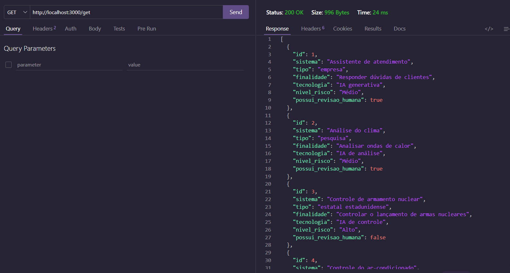
- ### Buscar um item pelo ID:
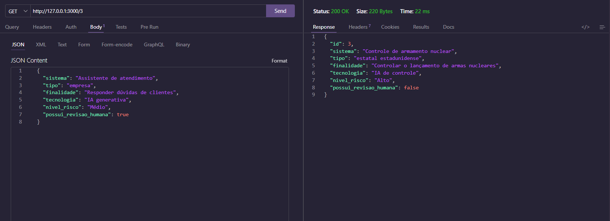
- ### Buscar um item pelo risco:
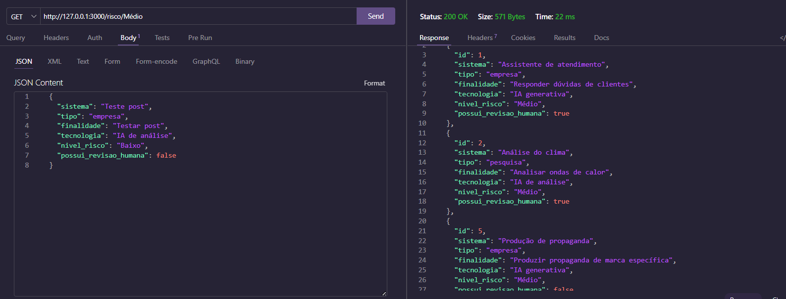
- ### Buscar um item pelo tipo:
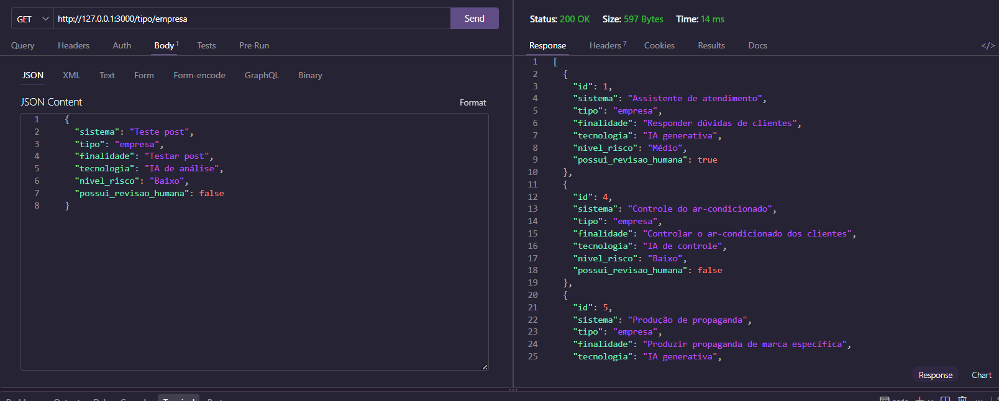
- ### Cadastrar um novo item usando Post e teste:
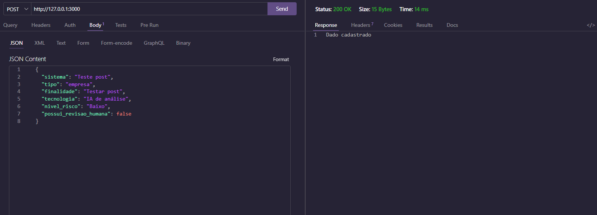
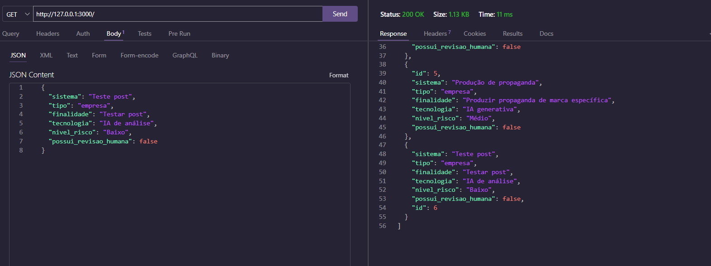
- ### Delete e teste:
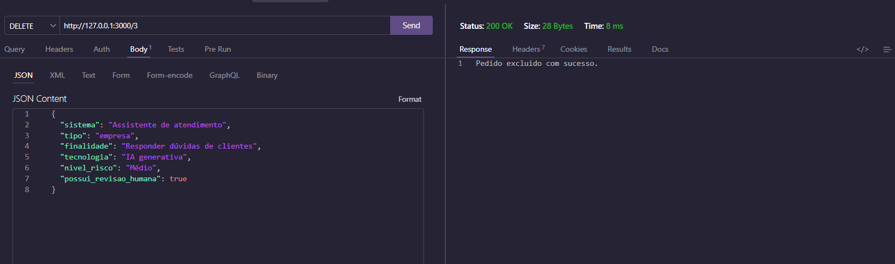
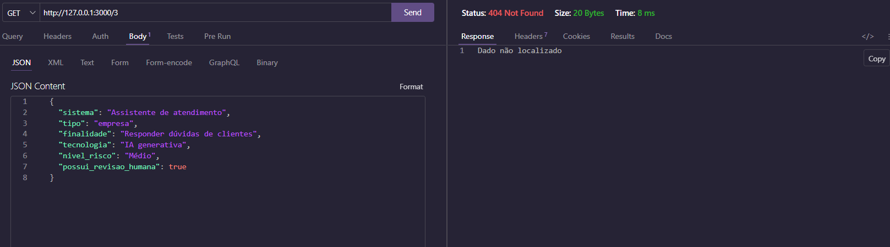
- ### Put e teste (note que "nivel_risco" e "possui_revisao_humana" foram alterados):
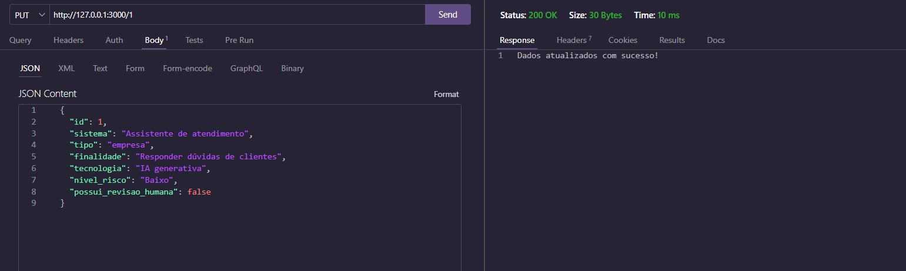
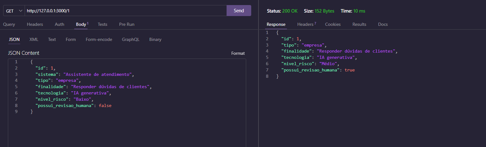
- ### Formulário e teste:<br>
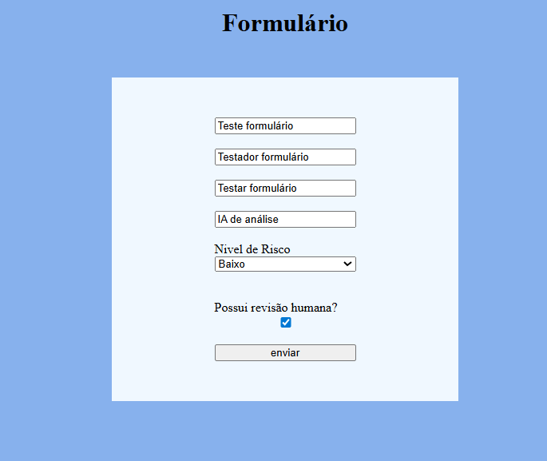
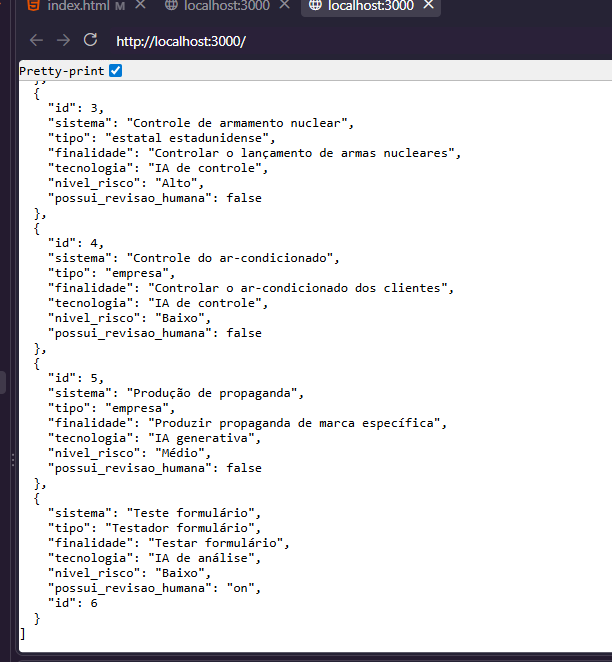

